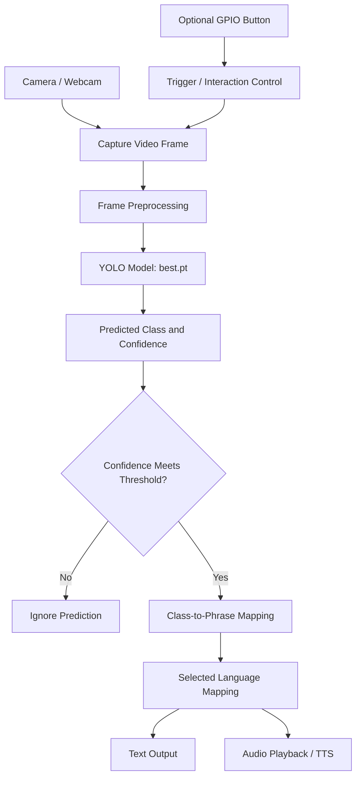

# Sign Language Detection to Speech in Regional Languages

<p align="center">
  <strong>An assistive-technology prototype that recognizes selected Indian Sign Language (ISL) gestures and communicates them as text and spoken audio.</strong>
</p>

<p align="center">
  Computer Vision · Deep Learning · Edge AI · Raspberry Pi · Text-to-Speech
</p>

> **Project status:** Prototype under development. The trained detection model is being deployed and tested on a Raspberry Pi. Camera-based inference and on-device performance testing are in progress. Replace the clearly marked evaluation fields in this README with measured results before presenting them as final.

---

## Table of Contents

- [Overview](#overview)
- [Problem Statement](#problem-statement)
- [Objectives](#objectives)
- [Key Features](#key-features)
- [System Architecture](#system-architecture)
- [End-to-End Pipeline](#end-to-end-pipeline)
- [Technology Stack](#technology-stack)
- [Hardware](#hardware)
- [Model and Detection Configuration](#model-and-detection-configuration)
- [Supported Signs and Languages](#supported-signs-and-languages)
- [Repository Structure](#repository-structure)
- [Installation](#installation)
- [Usage](#usage)
- [Raspberry Pi Deployment](#raspberry-pi-deployment)
- [Model Training and Updating](#model-training-and-updating)
- [Evaluation and Performance](#evaluation-and-performance)
- [Testing](#testing)
- [Limitations](#limitations)
- [Troubleshooting](#troubleshooting)
- [Future Improvements](#future-improvements)
- [Contributing](#contributing)
- [Acknowledgements](#acknowledgements)
- [License](#license)

---

## Overview

**Sign Language Detection to Speech in Regional Languages** is an assistive-technology project designed to make everyday communication easier between people who use sign language and people who may not understand it.

The prototype uses a computer-vision model to identify a supported hand gesture from a camera frame. The predicted class is mapped to a readable phrase and, where an audio mapping is configured, played as spoken output. The project is being tested on a Raspberry Pi so that recognition can run on a compact edge device rather than depending entirely on a cloud service.

The current implementation uses a trained YOLO model (`best.pt`). The prototype has also explored a landmark-based sequence-learning approach using MediaPipe and an LSTM model. These are different modelling approaches and should be documented separately if both are included in the final repository.

### Intended use

- Demonstrate computer-vision-based recognition of a limited set of signs.
- Convert recognized signs into text and preconfigured spoken phrases.
- Explore English, Hindi, and Gujarati audio output.
- Evaluate whether the system can run on affordable edge hardware.

This is a prototype, not a certified assistive or medical device. It should not be treated as a complete sign-language translator.

## Problem Statement

Communication can become difficult when a signer and a non-signer do not share a common communication method. This project explores a camera-based system that recognizes a defined vocabulary of signs and presents the result as text and speech.

The scope is deliberately limited to the classes represented in the model's training data. Recognition of a few isolated signs is not the same as understanding continuous sign language, grammar, facial expressions, or context.

## Objectives

1. Recognize selected hand gestures from live camera input.
2. Run inference using a trained computer-vision model.
3. Display or otherwise expose the predicted sign label.
4. Map supported labels to phrases and audio files or speech output.
5. Support configured English, Hindi, and Gujarati output options.
6. Deploy the prototype on Raspberry Pi hardware and measure real-world performance.
7. Document model quality, latency, and usability transparently.

## Key Features

- **Camera-based input:** Frames are captured from a connected camera or webcam.
- **Deep-learning inference:** The current detector loads trained weights from `best.pt`.
- **Confidence filtering:** Predictions below the configured confidence threshold can be ignored.
- **Phrase mapping:** Detected class labels are mapped to predefined phrases.
- **Audio output:** The prototype uses configured audio mappings for English, Hindi, and Gujarati.
- **Edge deployment:** Raspberry Pi deployment is being tested.
- **Optional interaction control:** The earlier prototype used Raspberry Pi GPIO button 17 as a trigger.
- **Cooldown:** A short cooldown can reduce repeated playback while the same sign remains visible.

Feature availability depends on the script and configuration present in the checked-out version of the repository. Update this section if the final code differs.

---

## System Architecture



### Component responsibilities

| Component | Responsibility |
|---|---|
| Camera | Supplies live frames containing the signer's hand or gesture. |
| Preprocessing | Prepares frames in the format and size expected by the detector. |
| YOLO detector | Predicts supported classes and confidence scores. |
| Confidence filter | Rejects low-confidence predictions based on a configured threshold. |
| Label mapping | Converts a model class into a human-readable phrase. |
| Language/audio mapping | Selects the configured phrase or audio asset for the chosen language. |
| Output layer | Displays text and plays the corresponding audio. |
| Raspberry Pi | Hosts the camera, inference process, and connected peripherals during edge tests. |

## End-to-End Pipeline

### 1. Video capture

The application reads frames from a connected camera or webcam. For Raspberry Pi deployment, the camera interface and capture library must match the hardware and operating-system configuration.

### 2. Preprocessing

Frames are resized and prepared for the model. The current prototype has used an inference image size of `256`; ensure that the runtime setting matches the model and the code being evaluated. Any color-space conversion or normalization should follow the requirements of the installed inference library.

### 3. Model inference

The application loads the trained weights file:

```text
best.pt
```

The detector predicts one or more supported classes and associated confidence scores. The exact architecture, training configuration, and class count should be taken from the model's training configuration and metadata rather than inferred from the filename.

### 4. Confidence filtering

The earlier prototype used a confidence threshold of `0.25`. A prediction below the configured threshold may be discarded.

```python
CONFIDENCE_THRESHOLD = 0.25
```

This value is a configuration choice, not a claim that the model is 25% accurate. Confidence threshold and detection accuracy are different metrics.

### 5. Class-to-phrase mapping

The predicted class is matched against the application's phrase mapping. The current prototype vocabulary has included:

- `Hello`
- `Yes`
- `No`
- `Thanks`
- `IloveYou`
- `Please`

The exact supported vocabulary is determined by the classes in the final model and the labels configured in the application. Keep model class names and application mapping keys consistent.

### 6. Language selection and audio output

The application uses language-specific audio mappings for English, Hindi, and Gujarati. Depending on the implementation, audio may be played from pre-recorded files or generated by a text-to-speech engine. Verify the final code before describing the output as live TTS: a prerecorded audio file is not the same as text-to-speech synthesis.

Example conceptual mapping:

```python
PHRASES = {
    "Hello": {
        "en": "Hello",
        "hi": "नमस्ते",
        "gu": "નમસ્તે",
    },
    "Yes": {
        "en": "Yes",
        "hi": "हाँ",
        "gu": "હા",
    },
}
```

This is an illustrative mapping only. Use the actual phrases and audio paths supported by your repository.

### 7. Debouncing and cooldown

A cooldown can prevent the same prediction from triggering audio repeatedly on every frame. The earlier prototype used a cooldown of approximately `2` seconds.

```python
COOLDOWN_SECONDS = 2
```

For more reliable behavior, consider requiring a prediction to remain stable across several frames before triggering output.

### 8. Edge deployment and measurement

The application is being tested on a Raspberry Pi with the connected camera. Measure performance on the actual target device because laptop or desktop results do not represent Raspberry Pi performance.

---

## Technology Stack

| Area | Technology / component | Purpose |
|---|---|---|
| Programming language | Python | Model inference and application logic |
| Computer vision | OpenCV and/or camera-specific capture library | Frame capture and image handling, depending on implementation |
| Object detection | YOLO / Ultralytics-compatible model | Gesture or sign-class detection |
| Model weights | `best.pt` | Trained detector weights |
| Audio playback | `pygame` in the earlier prototype | Playing configured audio assets |
| Edge computing | Raspberry Pi 5, 16 GB RAM | On-device deployment and testing |
| Camera | Raspberry Pi-compatible camera module | Live visual input |
| Optional hardware input | Raspberry Pi GPIO, pin 17 in the earlier prototype | Button-triggered interaction |

**Important:** Keep only the dependencies actually imported by the committed code in `requirements.txt`. Package names and versions should be pinned after testing the environment used for deployment.

### Explored sequence-model pipeline

A separate modelling path has explored MediaPipe hand landmarks and an LSTM sequence classifier:

1. Detect hand landmarks with MediaPipe.
2. Extract 21 hand landmarks per frame.
3. Represent each landmark using \(x\), \(y\), and \(z\) coordinates, giving \(21 \times 3 = 63\) features per frame.
4. Build fixed-length sequences of 30 frames.
5. Feed sequences into an LSTM classifier.
6. Map the predicted class to text and audio.

This can be useful for signs whose meaning depends on motion over time. It is **not the same pipeline as YOLO inference**. Include this branch in the deployed architecture only if the corresponding scripts and trained LSTM model are part of the repository and actively used.

---

## Hardware

### Current deployment target

| Component | Role | Status |
|---|---|---|
| Raspberry Pi 5 (16 GB RAM) | Runs the inference application | Deployment/testing target |
| Raspberry Pi-compatible camera module | Supplies live video | Camera performance testing in progress |
| Power supply and required cabling | Powers the Pi and camera | Confirm exact specifications for the build |
| Optional push button | User interaction trigger | GPIO 17 was used in an earlier prototype |

Record the exact camera model, Raspberry Pi OS version, power supply, and any cooling arrangement in the final deployment notes. Do not assume that every camera module uses the same interface or software setup.

## Model and Detection Configuration

The earlier YOLO-based prototype used the following settings:

| Parameter | Earlier prototype value | Meaning |
|---|---:|---|
| Model weights | `best.pt` | Trained detector checkpoint |
| Inference image size | `256` | Image size passed to inference, subject to the code's implementation |
| Confidence threshold | `0.25` | Minimum confidence accepted by the application |
| Cooldown | `2` seconds | Delay used to reduce repeated audio triggers |
| Optional GPIO input | `17` | Raspberry Pi GPIO button pin used in the earlier prototype |

These are historical prototype settings. Check the current source code before treating them as the exact configuration of a release.

### Model metadata to document

For reproducibility, record the following when available:

- Model family and exact version.
- Training dataset source and licence.
- Number of classes and class names.
- Number of training, validation, and test samples.
- Image size and augmentation settings.
- Optimizer, learning rate, batch size, and number of epochs.
- Training framework and version.
- Date and method of evaluation.
- The exact model checkpoint used in each reported test.

Do not commit private, restricted, or unlicensed datasets.

---

## Supported Signs and Languages

### Known prototype vocabulary

| Class label | Intended meaning |
|---|---|
| `Hello` | Greeting |
| `Yes` | Affirmative response |
| `No` | Negative response |
| `Thanks` | Expressing thanks |
| `IloveYou` | “I love you” |
| `Please` | Polite request |

Treat this list as the **known prototype vocabulary**, not a guaranteed statement of the final model's class count. Check the model's class metadata and mapping file before publishing the final count.

### Output languages

- English
- Hindi
- Gujarati

Language support refers to the configured phrase/audio mappings. It does not automatically mean that the model recognizes a separate sign vocabulary for each language.

---

## Repository Structure

A suggested structure for organizing the project is shown below. Adapt it to match the files that actually exist in your repository; these paths are a layout recommendation, not a claim that every file is already present.

```text
sign-language-to-speech/
├── README.md
├── requirements.txt
├── .gitignore
├── app.py                     # Main inference application, if named this way
├── best.pt                    # Trained model weights, if suitable to host on GitHub
├── config/
│   └── labels.json            # Class and phrase mappings, if used
├── audio/
│   ├── en/
│   ├── hi/
│   └── gu/
├── models/
│   └──                       # Additional model files, if applicable
├── data/
│   └── README.md              # Dataset instructions; avoid committing large/private data
├── scripts/
│   ├── train.py               # Training script, if available
│   └── evaluate.py            # Evaluation script, if available
├── tests/
│   └──                       # Unit/integration tests, if available
└── docs/
    ├── architecture.png       # Optional architecture diagram
    └── results/               # Evaluation charts and test notes
```

If `best.pt` is too large for GitHub's normal file limits, use Git LFS or publish it as a versioned release asset. Do not upload credentials, private datasets, or unrelated personal files.

---

## Installation

The commands below provide a starting point. Use the Python version and dependency versions supported by your actual model and Raspberry Pi environment.

### 1. Clone the repository

```bash
git clone https://github.com/<YOUR-USERNAME>/<YOUR-REPOSITORY>.git
cd <YOUR-REPOSITORY>
```

Replace the placeholders with your GitHub username and repository name.

### 2. Create a virtual environment

**Windows (PowerShell):**

```powershell
py -m venv .venv
.\.venv\Scripts\Activate.ps1
python -m pip install --upgrade pip
```

**Linux / Raspberry Pi OS:**

```bash
python3 -m venv .venv
source .venv/bin/activate
python -m pip install --upgrade pip
```

If the operating system requires system packages for camera access or audio playback, install the packages appropriate to your Raspberry Pi OS release.

### 3. Install Python dependencies

If the repository contains `requirements.txt`:

```bash
pip install -r requirements.txt
```

If it does not, create one from the dependencies imported by the project. Typical dependencies for this prototype may include Ultralytics, OpenCV, and pygame, but the exact list depends on the source code and Raspberry Pi compatibility.

```bash
pip install ultralytics opencv-python pygame
```

This is an example installation command, **not a verified universal dependency set**. Some Raspberry Pi camera configurations use different packages, and model frameworks can have platform-specific requirements. Test and pin compatible versions before publishing.

### 4. Check model and asset paths

Ensure that the application can locate:

- The trained checkpoint, such as `best.pt`.
- The configured class labels.
- The required audio files, if using prerecorded audio.
- Any configuration file referenced by the code.

Use relative paths based on the project directory where practical, rather than paths tied to one developer's computer.

---

## Usage

The exact command depends on the main Python entry point in the repository. If the application entry point is `app.py`, a typical launch command is:

```bash
python app.py
```

If your script has a different name, use that filename instead.

### Basic usage flow

1. Connect the camera and verify that the operating system can access it.
2. Activate the Python environment.
3. Confirm that the model checkpoint and audio assets are available.
4. Start the inference application.
5. Present one of the signs supported by the trained model.
6. Review the predicted label and confidence.
7. Confirm that the mapped text/audio output matches the prediction.
8. Repeat under different lighting, backgrounds, distances, and hand orientations.

### Example inference pseudocode

The following illustrates the logical flow. It is not a replacement for the project's actual application code.

```python
# Conceptual flow only
frame = camera.read()
predictions = model.predict(frame, imgsz=256)

for prediction in predictions:
    if prediction.confidence >= 0.25:
        label = prediction.class_name
        phrase = phrase_map.get(label)

        if phrase and cooldown_is_over():
            show_text(phrase)
            play_configured_audio(label, selected_language)
```

Use the inference API and output fields supported by the actual installed model library.

---

## Raspberry Pi Deployment

### Deployment checklist

1. Install a compatible Raspberry Pi OS release and updates.
2. Verify camera detection independently before launching the model.
3. Install a compatible Python runtime and inference dependencies.
4. Copy or download the model checkpoint and required assets.
5. Verify that model loading works before testing live video.
6. Test inference on a saved image or short video.
7. Test live camera capture and prediction.
8. Test audio playback and any GPIO interaction separately.
9. Run a sustained test and monitor latency, memory, temperature, and dropped frames.
10. Record results with the exact hardware, software versions, image size, and model checkpoint.

### Camera and performance considerations

- Camera APIs vary with the module and operating-system version.
- A model that runs on a desktop may run more slowly on a Raspberry Pi.
- Inference time is affected by model size, image size, runtime, camera capture, and post-processing.
- End-to-end response time includes more than the detector's inference time.
- Audio playback cooldown can affect how frequently outputs are triggered, but it is not detector latency.
- Avoid reporting FPS measured on a laptop as Raspberry Pi FPS.

---

## Model Training and Updating

The trained checkpoint `best.pt` is used by the current YOLO-based prototype. The repository should include training and evaluation scripts if they are available and permitted to be shared.

A reproducible training workflow should document:

1. Dataset collection and annotation.
2. Dataset split into training, validation, and test sets.
3. Class definitions and label consistency.
4. Model configuration and pretrained weights, if used.
5. Training parameters and random seeds where applicable.
6. Validation metrics and selection criteria for the best checkpoint.
7. Evaluation on a held-out test set.
8. Export and deployment checks on the target Raspberry Pi.

Do not claim that the model was trained from scratch unless that is true. If the checkpoint was fine-tuned from pretrained weights, state that explicitly and include the relevant licence and attribution.

### Dataset quality

For a more reliable evaluation, capture variation in:

- Signer and hand size.
- Lighting and background.
- Camera distance and orientation.
- Left and right hands, where applicable.
- Similar-looking signs.
- Different sessions and environments.

Avoid putting near-duplicate frames from the same video into both training and test splits, because that can inflate measured performance.

---

## Evaluation and Performance

**Do not publish unmeasured numbers as results.** Fill in this table using the actual evaluation graphs, confusion matrix, test logs, and Raspberry Pi measurements.

| Metric | What it measures | Result |
|---|---|---|
| mAP@0.5 | Mean Average Precision at an IoU threshold of 0.50, if applicable to the detector evaluation | `TODO: enter measured value` |
| Precision | Of the model's positive detections, the proportion that are correct | `TODO: enter measured value` |
| Recall | Of the ground-truth instances, the proportion detected by the model | `TODO: enter measured value` |
| Supported classes | Number of classes in the final trained model | `TODO: verify model metadata` |
| Raspberry Pi FPS | Frames processed per second under a documented test setup | `TODO: measure on target device` |
| Inference latency | Time for model inference per frame | `TODO: measure on target device` |
| End-to-end latency | Time from camera capture to visible/audio response | `TODO: measure on target device` |
| User testing | Number of participants, test conditions, task success, and feedback | `TODO: report only if conducted` |

### Understanding the metrics

- **mAP@0.5 is not the same as accuracy.** It evaluates detection quality across confidence thresholds using an Intersection over Union (IoU) threshold of 0.50. It is appropriate when the evaluation task is object detection with bounding boxes.
- **Classification accuracy** is the fraction of evaluated examples whose predicted class is correct. Use it only when the evaluation setup supports that definition.
- **FPS** is the number of frames processed per second. Higher FPS generally means more throughput.
- **Latency** is the time taken to produce a response. Lower latency generally means a faster interaction.
- **User testing** should report who participated in aggregate, what tasks they performed, how success was measured, and what limitations were observed. Do not claim user testing if the project has only been tested by its developers.

### Recommended Raspberry Pi benchmark method

1. Record the Pi model, RAM, OS, Python version, model checkpoint, inference image size, and camera settings.
2. Warm up the model before timing.
3. Measure a representative run over many frames rather than a single frame.
4. Report model-only inference latency separately from full camera-to-output latency.
5. Calculate FPS from the number of processed frames and elapsed time.
6. Repeat tests under consistent conditions and report the average plus a variability measure where possible.
7. Record whether audio playback and GPIO polling were enabled during the test.

Suggested result format:

```text
Device: Raspberry Pi 5, 16 GB RAM
Camera: <exact camera model>
Model checkpoint: <version or commit>
Inference image size: <value>
Confidence threshold: <value>
Test duration / frames: <value>
Average inference latency: <value> ms
End-to-end latency: <value> ms
Average throughput: <value> FPS
Evaluation dataset: <source and number of samples>
mAP@0.5: <value, if applicable>
```

---

## Testing

Test the system in layers so failures can be isolated:

| Test | Expected outcome |
|---|---|
| Model loading | Checkpoint loads without an error. |
| Static image inference | A supported sign can be processed from an image. |
| Camera capture | Frames are received consistently from the connected camera. |
| Label mapping | Every supported class maps to the correct phrase. |
| Language mapping | Each configured language selects the correct phrase or audio asset. |
| Audio playback | The mapped audio plays without repeated or overlapping triggers. |
| Confidence filtering | Low-confidence detections are handled according to configuration. |
| Cooldown | Repeated frames do not continuously retrigger the same audio. |
| Raspberry Pi soak test | The application remains stable during an extended run. |
| Performance benchmark | FPS and latency are measured and recorded using a repeatable method. |

Automated tests should be added for phrase mapping, missing audio files, invalid model labels, and cooldown behavior where practical.

---

## Limitations

- The system recognizes only the classes represented in the trained model.
- A limited set of isolated signs does not constitute full sign-language translation.
- Continuous signing may require temporal modelling and sentence-level interpretation.
- Sign meaning can depend on movement, facial expression, body posture, grammar, and context.
- Performance can change with lighting, occlusion, background, camera position, and signer variation.
- A model's confidence score is not a guarantee that its prediction is correct.
- Audio mapping quality depends on the accuracy and completeness of the configured phrase/audio assets.
- Raspberry Pi performance must be measured on the target hardware; it cannot be inferred from desktop results.
- Real-world usability and accessibility require structured testing with intended users.

## Troubleshooting

| Issue | Checks |
|---|---|
| Model file not found | Confirm the path to `best.pt` and the current working directory. |
| Camera not opening | Verify OS camera access, cable/interface, permissions, and capture API. |
| Missing Python package | Activate the correct environment and install the dependencies listed by the project. |
| Audio does not play | Check audio file paths, output device, supported file format, and pygame/audio initialization. |
| Hindi or Gujarati audio is unavailable | Confirm that language-specific assets or a compatible TTS engine are installed and configured. |
| Predictions are inconsistent | Check lighting, framing, confidence threshold, dataset coverage, and whether the sign is in the trained vocabulary. |
| Slow inference on Pi | Check image size, model architecture, CPU/GPU/runtime support, thermal throttling, and measured inference time. |
| Audio triggers repeatedly | Verify cooldown logic and consider requiring stable predictions across consecutive frames. |
| GPIO button is not detected | Confirm the physical pin mapping, GPIO library, permissions, wiring, and pull-up/pull-down configuration. |

---

## Future Improvements

- Expand the sign vocabulary with a carefully labelled dataset.
- Improve robustness across signers, lighting conditions, and backgrounds.
- Add temporal smoothing to reduce unstable frame-by-frame predictions.
- Evaluate a landmark-sequence model for signs that depend on motion.
- Optimize the detector for Raspberry Pi inference and compare supported runtimes.
- Separate detector latency from camera-to-audio response time in benchmarks.
- Add a clean language-selection interface and configurable audio mappings.
- Build automated tests and a reproducible evaluation pipeline.
- Conduct structured usability testing with participants from the intended user group.
- Document accessibility, privacy, dataset licensing, and model limitations.

## Contributing

Contributions are welcome. Before opening a pull request:

1. Explain the problem or improvement.
2. Keep class names and phrase mappings consistent.
3. Include reproducible test steps.
4. Do not add datasets or media without permission to redistribute them.
5. Include measured evidence for performance claims.
6. Document hardware-specific changes and dependency versions.

## Acknowledgements

This project brings together computer vision, deep learning, embedded computing, and audio output to explore more accessible communication. Add the actual dataset creators, model/framework references, contributors, mentors, and institutional acknowledgements here, following their attribution requirements.

## License

No licence has been specified in this README. Add a `LICENSE` file before publishing if you want others to know what they are permitted to use, modify, and redistribute. Also verify the licences of any dataset, pretrained weights, and third-party assets included in the repository.
