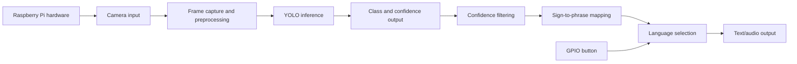

# Technical Design Document

## A. Introduction

This project builds a real-time sign language recognition system for six common phrases: `Hello`, `IloveYou`, `No`, `Please`, `Thanks`, and `Yes`. The repository combines computer vision and audio output to convert recognized sign language gestures into spoken phrases in English, Hindi, or Gujarati.

The core detection pipeline uses Ultralytics YOLOv8, which is trained on a dataset stored under `data/`. Inference runs on a live camera stream and filters detections by confidence and repetition rate before triggering an audio response. The system is designed for desktop environments and can also operate on a Raspberry Pi with a GPIO button for language switching.

### Problem and intended users

The intended users are individuals who rely on sign language and communicate with people who do not know the same signs. This system improves communication access for schools, clinics, public service kiosks, and other accessibility-focused use cases.

### Scope and limitations

The scope of this version is limited to the six labeled signs included in the dataset and a single model checkpoint. It does not claim general-purpose sign recognition beyond the provided vocabulary. Light levels, camera framing, and motion blur can change detection reliability in real-world use.

## B. System architecture

This design matches the code path in `detect.py`: the webcam is opened as a video source, the model runs `model.predict(...)`, and each class is mapped to a phrase and audio file in the currently selected language.

## C. Component design

### Camera input

The camera source is configured by `model.predict(source=0, conf=0.25, imgsz=256, show=True, stream=True)`. This allows either a local webcam or a Raspberry Pi camera module, depending on the host environment.

### Detection model

The trained weights are stored at `runs/detect/train/weights/best.pt`. The model is loaded through `YOLO(...)` and exposes `model.names` for the class-to-label mapping. The class number to name mapping is:

- 0: Hello
- 1: IloveYou
- 2: No
- 3: Please
- 4: Thanks
- 5: Yes

### Dataset and class mapping

The dataset configuration is in `data/data.yaml` and defines the number of classes and the label order. This file is used by the training pipeline and must stay consistent with the model outputs.

### Language mapping

The system supports language mappings for `English`, `Hindi`, and `Gujarati`. These are defined in `detect.py` and correspond to audio directories under `audio/en`, `audio/hi`, and `audio/gu`.

### Audio playback

The runtime audio playback uses `pygame.mixer` and loads MP3 files in a background thread so the camera loop is not blocked while each phrase is spoken.

### Hardware interface

The GPIO interface is optional. It is implemented using `RPi.GPIO` only when the runtime is on a Raspberry Pi and the module is available. The button toggles the active language with a debounced `FALLING` event.

## D. Model and data pipeline

### Dataset structure

The project stores labeled images under `data/train/images`, `data/train/labels`, `data/test/images`, and `data/test/labels`.

### Training configuration

The training configuration is recorded in `runs/detect/train/args.yaml`. The final run used the YOLOv8n pretrained model with 99 epochs and a `data.yaml` dataset definition.

### Model weights and inference workflow

The model file used at runtime is:

- `runs/detect/train/weights/best.pt`

The runtime workflow is:

1. Capture a frame from the camera.
2. Run object detection with YOLO.
3. Read all class IDs from `result.boxes.cls`.
4. Filter out unsupported labels or duplicate playback events using the cooldown logic.
5. Look up the label in the active language map.
6. Trigger `pygame` playback of the MP3 file.

## E. Hardware architecture

### Mandatory hardware

- A PC or Raspberry Pi capable of running Python 3.10+.
- A webcam or Raspberry Pi camera.
- Audio output device.

### Optional hardware

- Raspberry Pi GPIO button for language switching.
- External speaker for audible playback.

### Platform-specific dependency

- Desktop/Linux/macOS: `requirements.txt`
- Raspberry Pi: `requirements-pi.txt`

## F. Installation and deployment

### Desktop development

1. Create a virtual environment.
2. Install dependencies via `pip install -r requirements.txt`.
3. Confirm the model loads successfully.
4. Run `python detect.py`.

### Raspberry Pi deployment

1. Install the Pi-specific requirements.
2. Connect the camera and optional button.
3. Run the application with Python.
4. Press the button to switch language selection.

## G. Performance evaluation

The validation metrics captured in `runs/detect/train/results.csv` show the following final training values:

- Precision(B): 0.98819
- Recall(B): 1.0
- mAP@0.5(B): 0.995
- mAP@0.5:0.95(B): 0.39403

These values describe the training-validation run included in the repository. They are useful for model sanity-checking, but they do not fully represent real-world end-user accuracy. Real deployment performance still depends on lighting, camera angle, sign consistency, and device compute capabilities.

## H. Limitations and future improvements

- Supported vocabulary is limited to six classes.
- Lighting and background conditions can reduce recognition quality.
- Inference latency on low-power devices may vary significantly.
- The project provides offline audio playback only after the MP3 files are present.
- Future improvements could include more signs, a larger dataset, a confidence threshold tuning workflow, and a stronger hardware abstraction to simplify testing.
